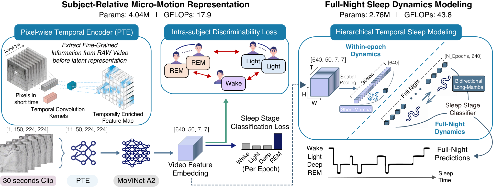

# ViNUSS: Subject-Relative Micro-Motion and Sleep Dynamics for Near-Infrared Video Sleep Staging

[](https://arxiv.org/abs/2609.05550)
[](https://neurips.cc/Conferences/2026)
[](LICENSE)

Official PyTorch implementation of

> **Subject-Relative Micro-Motion and Sleep Dynamics for Near-Infrared Video Sleep Staging**
> Kunmin Jang\*, You Rim Choi\*, Hun Heo, Heonjun Lee, Suahn Bae, Dongik Park, Hyun-Woo Shin†, Hyung-Sin Kim†
> Seoul National University / Seoul National University Hospital
> *NeurIPS 2026* · [arXiv:2609.05550](https://arxiv.org/abs/2609.05550)
> (\* equal contribution, † corresponding authors)

<p align="center">
  
</p>

ViNUSS (Video-Native Unmediated Sleep Staging) scores sleep stages directly from near-infrared
(NIR) video in two stages:

* **Stage 1** learns an epoch-level (30 s) representation of subject-relative micro-motion: a
  Pixel-Wise Temporal Encoder (PTE) in front of a MoViNet-A2 backbone, trained with cross-entropy
  plus an Intra-Subject Discriminability Loss (ISDL).
* **Stage 2** (Sleep Dynamics Modeling, SDM) runs a ShortMamba over each epoch and a bidirectional
  LongMamba over the whole night, and predicts every epoch of the night at once.

Code map: PTE = `stem_conv` in `models/movinet.py` · ISDL = `double_loss` mode in
`data/video_dataset.py` + triplet loss in `train_stage1.py` · SDM = `DoubleMambaModel` in
`models/mamba.py`.

On 475 overnight recordings (~3,250 h) from the Korea Video Sleep Study (KVSS), ViNUSS reaches
0.80 accuracy, 0.68 Cohen's κ and 0.78 macro-F1 for four-class (Wake / Light / Deep / REM) staging.

## Installation

Tested with Python 3.8, CUDA 12.1 and PyTorch 2.4.0.

```bash
conda create -n vinuss python=3.8 -y && conda activate vinuss
pip install torch==2.4.0 torchvision==0.19.0 --index-url https://download.pytorch.org/whl/cu121
pip install -r requirements.txt
pip install mamba-ssm==2.2.2 --no-build-isolation
```

* `mamba-ssm` ([state-spaces/mamba](https://github.com/state-spaces/mamba)) is a CUDA extension
  built against the installed PyTorch, hence the separate step.
* Stage 1 training downloads the Kinetics-600 MoViNet-A2 weights from
  [Atze00/MoViNet-pytorch](https://github.com/Atze00/MoViNet-pytorch) on first run.

## Dataset (KVSS)

KVSS: 475 overnight NIR recordings with synchronized PSG and AASM sleep-stage annotations,
available from AI Hub (Korea) after a data-use application is approved:
<https://aihub.or.kr/aihubdata/data/view.do?currMenu=115&topMenu=&aihubDataSe=data&dataSetSn=638>.

### Preprocessing

`preprocess/video_to_h5.py` converts each KVSS recording (MP4 + annotation JSON) into one HDF5
file per subject (Appendix B.2 of the paper): `frames` (uint8, `(E, 150, 224, 224)`), `labels`
(`(E,)`, 0=Wake 1=N1 2=N2 3=N3 4=REM) and `num_epochs` (the keys the loaders read). Expected layout: `<input_dir>/<subject>/<subject>_video_01.mp4`
and `<subject>_annotation.json`. Frames are converted to grayscale, cropped to rows 20:420 /
cols 120:520 of the 640×480 frame (`--crop`) and resized to 224×224.

```bash
python preprocess/video_to_h5.py \
    --input_dir  /path/to/KVSS/raw \
    --output_dir /path/to/kvss_h5/224x224 \
    --size 224 --workers 5
```

Create `data/splits/` and list the subjects in `train.txt`, `valid.txt` and `test.txt`, one
`<subject>.h5` per line (all three files must exist). The paper split is stratified by sex, age
and OSA severity.

## Training

Set `data_config.data_path` in `configs/stage1_train.yaml` to your HDF5 directory;
`stage2_train.yaml` reads `./features`, written by `extract_features.py` below. The other
settings are the paper's. Both configs use 2 GPUs (`learning_config.gpus`). Effective batch =
`batch_size_t × accumulate_grad_batches × #GPUs`: 8 triplets (Stage 1), 64 nights (Stage 2).

**Stage 1 (PTE + ISDL)**

```bash
python train_stage1.py --config configs/stage1_train.yaml
```

Checkpoints (best validation macro-F1) are saved to `experiments/stage1/<experiment_name>/`.

**Feature extraction**

```bash
python extract_features.py \
    --checkpoint experiments/stage1/<experiment_name>/<best>.ckpt \
    --data_path  /path/to/kvss_h5/224x224 \
    --output_path ./features
```

**Stage 2 (SDM)**

```bash
python train_stage2.py --config configs/stage2_train.yaml
```

## Checkpoints

Available on the [Releases](https://github.com/alex-kunmin-jang/ViNUSS/releases) page.

| File | Contents |
|---|---|
| `stage1.ckpt` | Stage 1: PTE + MoViNet-A2 (with the ISDL projection head) |
| `stage2.ckpt` | Stage 2: SDM (ShortMamba + bidirectional LongMamba) |

## Evaluation

Create `checkpoints/` and `data/splits/`. Put the released checkpoints in `checkpoints/` and the
test subjects in `data/splits/test.txt` (`train.txt` and `valid.txt` must exist but may be
empty). From extracted features (`features_release/`, separate from `features/` above):

```bash
python extract_features.py --checkpoint checkpoints/stage1.ckpt \
    --data_path /path/to/kvss_h5/224x224 --output_path ./features_release
python train_stage2.py --config configs/stage2_test.yaml --test
python evaluate.py --predictions experiments/stage2/ViNUSS_stage2_test/test_results.csv --bootstrap 1000
```

or run both stages end to end on the video HDF5 files:

```bash
python inference.py \
    --stage1_ckpt checkpoints/stage1.ckpt \
    --stage2_ckpt checkpoints/stage2.ckpt \
    --data_path   /path/to/kvss_h5/224x224 \
    --output_path results/
python evaluate.py --predictions results/predictions.csv --bootstrap 1000
```

`evaluate.py` prints accuracy, macro-F1, Cohen's κ, per-class scores and the confusion matrix for
the 5-class and the 4-class (N1+N2 → Light, N3 → Deep) settings; `--bootstrap N` adds
subject-level 95% confidence intervals and `--output DIR` writes `metrics_{5,4}class.json`.

### Results (KVSS test set, 70 subjects / 57,918 epochs; Table 1 and Appendix Table D.1 of the paper)

| Setting | Acc | κ | MF1 | Wake F1 | Light F1 | N1 F1 | N2 F1 | Deep F1 | REM F1 |
|---|---|---|---|---|---|---|---|---|---|
| 4-class (Wake / Light / Deep / REM) | **0.80** | **0.68** | **0.78** | 0.78 | 0.83 | – | – | 0.67 | 0.82 |
| 5-class (Wake / N1 / N2 / N3 / REM) | 0.71 | 0.62 | 0.72 | 0.78 | – | 0.58 | 0.72 | 0.67 | 0.82 |

## Citation

```bibtex
@inproceedings{jang2026vinuss,
  title     = {Subject-Relative Micro-Motion and Sleep Dynamics for Near-Infrared Video Sleep Staging},
  author    = {Jang, Kunmin and Choi, You Rim and Heo, Hun and Lee, Heonjun and Bae, Suahn and Park, Dongik and Shin, Hyun-Woo and Kim, Hyung-Sin},
  booktitle = {Advances in Neural Information Processing Systems (NeurIPS)},
  year      = {2026},
  note      = {arXiv:2609.05550}
}
```

## License

Code and released weights: academic, non-commercial research only ([LICENSE](LICENSE));
commercial licensing via the corresponding authors.

## Acknowledgements

* MoViNet-A2 code and Kinetics-600 weights: [Atze00/MoViNet-pytorch](https://github.com/Atze00/MoViNet-pytorch) (MIT).
* Mamba layers: [state-spaces/mamba](https://github.com/state-spaces/mamba) (Apache-2.0).
* Config container: [fvcore](https://github.com/facebookresearch/fvcore) (Apache-2.0).
* KVSS: AI Hub (Korea) and Seoul National University Hospital.

## Contact

* Kunmin Jang — jangk10@snu.ac.kr
* You Rim Choi — yrchoi@snu.ac.kr
* Hyun-Woo Shin† — charlie@snu.ac.kr
* Hyung-Sin Kim† — hyungkim@snu.ac.kr
